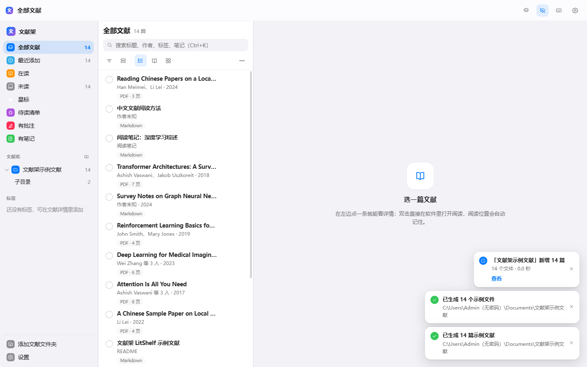
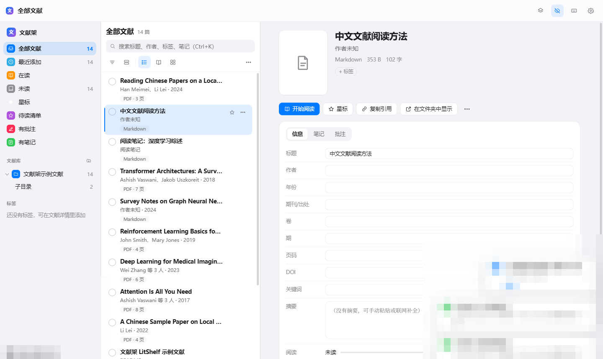
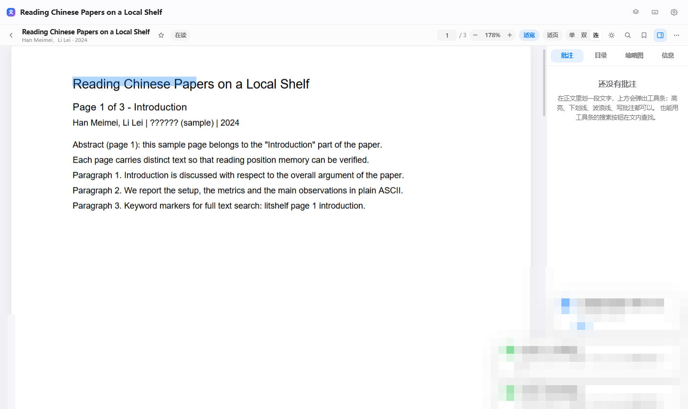
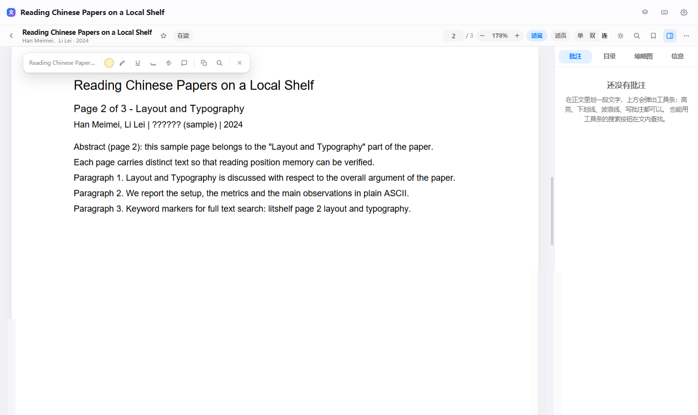
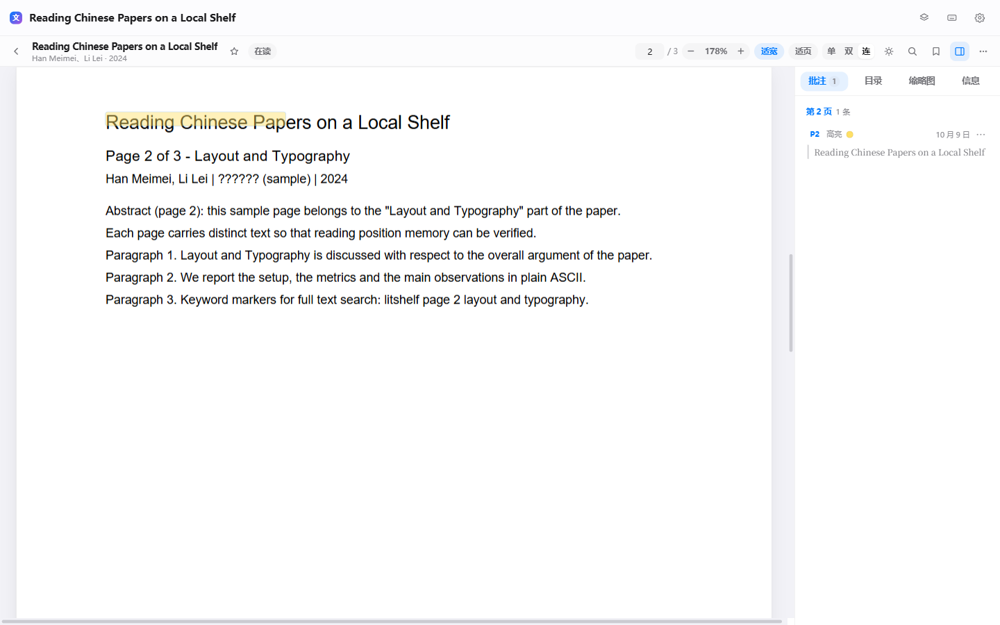
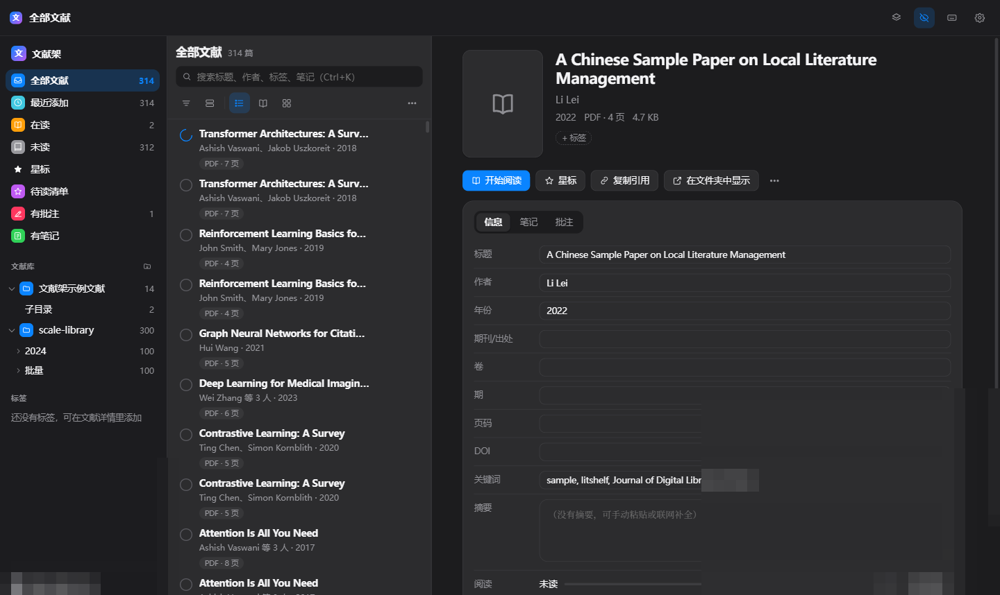
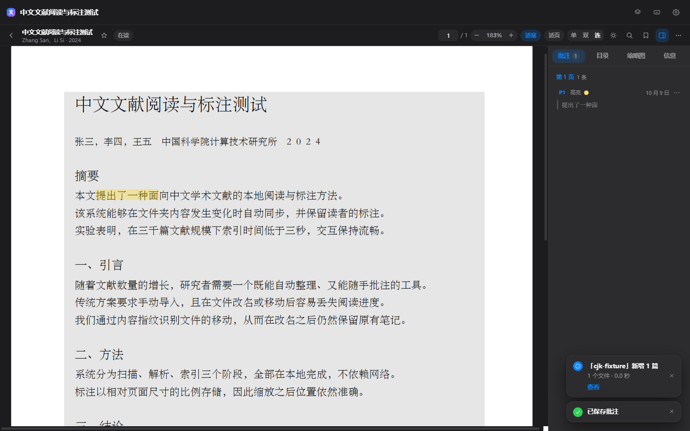
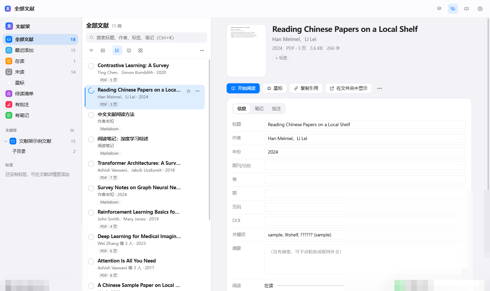

#由于我用不习惯zetero，所以拿大肥鱼做了这个，全是ai生成的，所以对我来说相对来说比较轻松，目前已知bug还是很多的，后续我会一直更新的，因为我自己也会用的，希望有优化的地方能说出来，不好的可喷，我会让大肥鱼继续改进的

# 文献架 LitShelf

[](https://github.com/blueric4/litshelf-reader/actions/workflows/ci.yml)
[](LICENSE)
[](https://www.electronjs.org/)
[](https://react.dev/)
[](https://www.typescriptlang.org/)

> 像视频播放器扫描影片库一样扫描你的文献文件夹；像 Apple 提醒事项一样清爽地管理；在软件内直接阅读 PDF 并做高亮批注。

**三条主线**：① 指一个文件夹，自动识别里面的文献；② 在软件内直接打开阅读，不跳出到系统阅读器；③ **文件夹里的文件变了（新增/改名/删除/覆盖保存），软件内自动跟着变，且绝不丢你的标签、笔记、批注和阅读位置。**

> **只想用、不想配环境？** 到 [Releases](https://github.com/blueric4/litshelf-reader/releases) 下载绿色免安装版（zip，解压后双击 `文献架 LitShelf.exe` 即用，无需安装 Node.js）；也可以自己打：`node tools/make-portable.mjs`。

---

## 快速开始

### 方式零：绿色免安装整合版（**发给别人 / 换电脑用这个**）

```bash
node tools/make-portable.mjs      # 构建 + 组装绿色版（默认输出到项目上一级的 文献架整合/）
node tools/smoke-portable.mjs     # 验收整合版（可传 exe 路径；--real-data 走真实数据目录）
```

产物是一个 Electron 标准便携目录（`文献架整合/`）：

- 双击其中的 **`文献架 LitShelf.exe`** 即可打开，不需要装 Node.js、不需要装任何依赖；
- 整个文件夹可以压缩成 zip 发给别人，对方解压后双击同一个 exe 就能用；
- 软件数据（书签/批注/笔记/阅读位置/缩略图缓存）存在 `%APPDATA%\文献架 LitShelf`，**不写进这个文件夹**，所以整包可以随便拷来拷去；
- 打包时会自动收集主进程需要的**生产依赖闭包**（含 pnpm 传递依赖与软链接解引用）、裁剪多余语言包与 sourcemap。

### 方式一：双击启动（源码态）

双击项目根目录的 **`启动文献架.bat`**（需先装 Node.js 20 或更高版本）。它会自动判断：依赖没装就装、没构建就构建、然后打开桌面窗口；若找不到 Electron 运行时，会自动改用浏览器形态并打开 http://127.0.0.1:7788 。

### 方式二：命令行（开发态）

```bash
pnpm install          # 首次
pnpm dev              # 桌面形态：Vite 开发服务器 + Electron 窗口，改代码即时生效
pnpm dev:web          # 浏览器形态：http://127.0.0.1:7788
pnpm build            # 生产构建（渲染层 + 主进程 + preload + 服务端）
pnpm start:web        # 构建并以浏览器形态运行
pnpm test             # 单元测试（文件变化对账状态机、批注重定位、检索、原子写…）
pnpm typecheck        # TypeScript 严格检查
pnpm dist             # 打包成 Windows 安装包（release/，需要 electron-builder 可用）```

首次打开会进入引导页：选择文献文件夹 → 选扫描策略（递归深度，默认 8 层）→ 开始。也可以在引导页点「先生成示例文献看看」，它会往 `文档\文献架示例文献` 写 14 个示例文件（8 篇手写多页 PDF + 4 篇 Markdown + 2 篇 TXT，含一个子目录）并自动入库，立刻就能试全部功能（随时可在设置里移除这个库、把文件夹删掉）。



| 引导页 | 详情栏 | 阅读器 |
| --- | --- | --- |
|  |  |  |

| 划词工具条 | 高亮落库 + 批注侧栏 | 深色模式 |
| --- | --- | --- |
|  |  |  |

| 中文划词逐字对齐（拖 6 个汉字正好选中 6 个） |
| --- |
|  |

| 文件夹里新增文件后自动同步 |
| --- |
|  |

---

## 核心机制：文件夹怎么"自动跟着变"

软件**只读取**你的文件夹，绝不改名、移动、删除你的文件。所有索引与用户数据都在本地数据目录里。

| 你在文件夹里的操作 | 软件内的表现 |
| --- | --- |
| 新增文件 | 文件写入稳定（1.5 秒）后自动出现在列表，右下角提示"已添加 N 篇"（提示每 0.9 秒合并一次） |
| 改名 / 移动 | 条目**原地更新**（靠内容指纹识别），标签、星标、笔记、批注、阅读进度一个不少，列表位置不跳 |
| 删除文件 | 条目标记为「文件缺失」（不删除条目），笔记批注仍在；文件放回去会自动恢复 |
| 用别的软件覆盖保存 | 自动重新解析页数与元数据；已有的高亮批注按**文本锚点**重新定位，失败的在阅读器里标为「待确认」，绝不会静默丢弃 |
| 新增子文件夹 | 自动纳入（默认最多 8 层，可改） |
| 同名复制一份 | 识别为"新增一篇"，不会和原文件混淆 |
| 拖入一半的大文件 | 等文件写入稳定（1.5 秒）后才处理，不会读到半个文件 |
| 网盘/移动硬盘整块下线 | 列表上方黄条提示"有文献库当前打不开：…（可能是移动硬盘或网盘未挂载）"，不会把整库标记成缺失；恢复后自动核对 |

另外每 5 分钟做一次一致性巡检（设置里可改成每分钟 / 每 15 分钟 / 关闭），兜底那些不推送文件系统事件的网盘目录。

---

## 界面与操作

- **三栏**：左侧智能列表 + 文献库文件夹树 + 标签；中间列表（紧凑/舒适/网格三种视图，可排序分组）；右侧详情（信息 / 笔记 / 批注）。
- **双击**任意条目即在软件内打开阅读。
- **阅读器**：连续滚动/单页/双页、适应宽度、适应页面（**双击页面**在两者间切换）、25%–400% 缩放、目录、缩略图、阅读主题（浅色 / 护眼 / 深色）、全屏、文内搜索、阅读位置自动记忆；选中文字后按 `1`/`2`/`3`/`4` 直接标注，也可以**右键**选中文字或页面空白弹出操作菜单。
- **批注**：鼠标框选文字 → 高亮 / 下划线 / 波浪线 / 删除线 / 批注，外加复制与「在文内搜索」，五色可选；右侧按页码分组，点击跳回原文；支持书签。**已经高亮过的文字照样能划过选中**（批注层对鼠标透明，点击批注走几何命中），所以可以在一段文字上叠加多种标记。
- **右键菜单**（阅读器内）：选中文字右键 → 高亮 / 下划线 / 波浪线 / 删除线 / 复制 / 复制引用（选区文字 + GB/T 7714 题录，中间空一行）/ 在文内搜索；页面空白右键 → 适应宽度 / 适应页面 / 加书签 / 复制引用（整篇）。菜单贴边自动向内收，`Esc`、点击别处、滚动、缩放、换页都会关掉；右键不会清掉你已经选中的文字。
- **检索**：支持语法 `tag:待精读`、`author:张`、`year:2023..2025`、`is:unread`、`is:starred`、`is:annotated`、`title:`、`note:`、`doi:`（另有 `is:read` / `is:missing` / `is:note` / `ann:` / `kind:` / `ext:` / `folder:`），回车可搜 PDF 正文（需已建立全文索引）。文件名也参与匹配。
- **导出**：BibTeX / RIS / CSL-JSON / CSV / 笔记与批注 Markdown；单篇可复制引用（GB/T 7714、APA、IEEE、MLA）。

### 快捷键

| 按键 | 作用 |
| --- | --- |
| `Ctrl/⌘ + K` | 聚焦搜索框 |
| `j` / `k`、`↑` / `↓` | 上下移动选择 |
| `Enter` | 打开选中的文献 |
| `Space` | 切换已读 / 未读 |
| `s` | 切换星标 |
| `e` | 跳到笔记 |
| `d` | 显示 / 隐藏详情栏 |
| `Esc` | 返回列表 / 清空搜索 |
| `?` | 打开快捷键面板（文献库与阅读器共用同一个） |
| `Ctrl/⌘ + R` | 重新扫描全部文献库 |

阅读器内（与 `?` 打开的面板逐条一致）：

| 按键 | 作用 |
| --- | --- |
| `←` / `PageUp` / `[` | 上一页 |
| `→` / `PageDown` / `Space` / `]` | 下一页 |
| `Home` / `End` | 首页 / 末页 |
| `b` | 加书签 |
| `Ctrl/⌘ + F` | 文内搜索 |
| **`Ctrl/⌘ + 滚轮`** | **放大 / 缩小**（只缩放文献，不动界面；不会误触发浏览器整页缩放） |
| `Ctrl/⌘ + =` / `Ctrl/⌘ + -` | 放大 / 缩小 |
| `Ctrl/⌘ + 0` | 适应宽度 |
| `+` / `-` | 放大 / 缩小 |
| 双击页面 | 在「适应宽度 / 适应页面」之间切换（PDF） |
| `t` | 切换阅读主题（浅色 / 护眼 / 深色，带提示） |
| `f` | 全屏 |
| `Ctrl/⌘ + Shift + =` / `-` / `0` | 缩放界面本身（视图菜单里的那三项） |
| `1` / `2` / `3` / `4` | 选中文字后直接加：高亮 / 下划线 / 波浪线 / 删除线 |
| 鼠标右键 | 选中文字或页面 → 菜单（高亮、复制、复制引用、文内搜索、适宽适页、书签） |
| `Esc` | 有浮层（搜索 / 批注卡片 / 划词工具条）时**只关浮层**，再按一次返回列表 |
| `?` | 打开快捷键面板（文献库与阅读器共用同一个面板） |
| `←` / `→`（图片阅读器） | 上一张 / 下一张图片 |

> 已经高亮过的文字仍然可以鼠标划过重新选中（批注标记层对鼠标透明），所以能在一段文字上叠加多种标记；单击已有高亮则打开批注卡片；有浮层时按 `Esc` 只关浮层，不会把阅读器一起关掉。右键菜单也不会清掉你已经选中的文字，`Esc` 只关菜单本身。

界面本身的缩放（**视图**菜单）用的是 `Ctrl/⌘ + Shift + =` / `Ctrl/⌘ + Shift + -` / `Ctrl/⌘ + Shift + 0`；不带 Shift 的 `Ctrl/⌘ + =` / `-` / `0` 与 `Ctrl/⌘ + 滚轮` 全部留给阅读器，两者不会叠成"双重缩放"。

---

## 支持的格式

| 格式 | 入库 | 软件内阅读 |
| --- | --- | --- |
| PDF | ✅ | ✅ 全功能（滚动/缩放/目录/文内搜索/高亮批注/书签） |
| Markdown / TXT / HTML | ✅ | ✅ 渲染阅读（代码高亮、表格、公式），可切源码 |
| PNG / JPG / WebP / GIF / BMP / TIFF / AVIF | ✅ | ✅ 缩放、旋转 90°、同目录左右切换（`←` / `→` 或工具条按钮） |
| DOCX | ✅ | ✅ 基础只读渲染（标题、段落、表格、图片） |
| EPUB | ✅ | ✅ 章节阅读（自带解析，不依赖第三方阅读器） |
| CAJ / NH / DOC / RTF / DJVU 等 | ✅ | ⚠️ 显示信息卡，可「用系统程序打开」 |
| 其他任意文件 | 可选（设置里开） | ❌ 仅登记 |

---

## 数据存在哪

| 内容 | 位置 |
| --- | --- |
| 库索引、设置 | `%APPDATA%\文献架 LitShelf\library.json`、`settings.json`（写入采用"临时文件 + rename"原子写，并保留 `.bak` 备份） |
| 笔记 | `%APPDATA%\文献架 LitShelf\notes\<条目id>.md`（可以用别的编辑器直接改，软件启动时会读回来；软件退出时**不会**覆盖你在外部改的内容） |
| 批注 | `%APPDATA%\文献架 LitShelf\annotations.json` |
| 缩略图 / 全文索引 | `%APPDATA%\文献架 LitShelf\cache\` |
| 日志 | `%APPDATA%\文献架 LitShelf\logs\`（设置页可一键导出诊断报告） |
| 导出的文献库 | `%APPDATA%\文献架 LitShelf\exports\` |

桌面形态与浏览器形态**共用同一份数据**（`src/main/index.ts` 与 `src/server/index.ts` 都读同一个变量）。用环境变量 `LITSHELF_DATA_DIR` 可以指定别的数据目录——便携模式、或跑自动化测试时隔离数据（`tools/e2e-desktop.mjs`、`tools/acceptance.mjs`、`tools/acceptance-cjk.mjs` 就是这么做的，绝不碰你的真实文献库）。

---

## 常见问题

**Electron 装不上 / 打不开窗口？**
用浏览器形态，功能完全一致：`pnpm dev:web`，然后打开 http://127.0.0.1:7788 。`启动文献架.bat` 也会自动降级。

**中文 PDF 显示成方块？**
pdf.js 的中文支持依赖 `cmaps` 与标准字体资源，构建脚本会自动从 `pdfjs-dist` 同步到 `src/renderer/public/`。若你手动删过这些文件，跑一次 `pnpm build` 即可恢复。

**为什么有些文献没有作者/年份？**
元数据来自 PDF 内嵌信息，扫描件或劣质导出常常是空的。文献架会用**文件名启发式**解析（`作者 - 年份 - 标题.pdf` 等常见命名），也可以在详情里手动填写——手动改过的字段会被锁定，后续扫描不会覆盖（可用"解除字段锁定"放回自动模式），或点「补全元数据」用 Crossref / arXiv 联网补齐。

**会不会动我的文件？**
不会。软件的写操作只发生在上面的数据目录里。删除条目只是从库里移除记录，磁盘文件不动。

**担心批注丢了？**
文件被覆盖保存后，批注会按文本锚点重新定位；定位失败也不会删除，而是在阅读器右侧栏进入「待确认」分组，可以手动处理。批注与笔记另有一份 Markdown 导出（`导出 → 笔记与批注`）。

**库很大（上万篇）会不会卡？**
扫描分三段：发现（先出条目）→ 指纹 → 后台解析元数据，界面全程可交互；列表虚拟滚动；PDF 阅读只渲染可视页 ±2 页。

---

## 工程结构

```
src/
├─ shared/            类型与宿主 API 契约（IPC 与 HTTP 共用）
├─ core/              平台无关核心
│   ├─ library.ts       ★ 文件系统对账状态机（新增/改名/删除/覆盖/复活）
│   ├─ fingerprint.ts   分块内容指纹（识别改名与移动）
│   ├─ reanchor.ts      批注文本锚点重定位
│   ├─ search.ts        查询语法与打分
│   ├─ extract.ts       PDF/DOCX/TXT 元数据与正文抽取
│   ├─ store.ts         原子写 + .bak 回滚 + 日志
│   ├─ host.ts          ★ 编排：扫描队列、监听、事件广播、API 实现
│   └─ ...
├─ main/              Electron 主进程（窗口、托盘、litfile:// 协议、IPC）
├─ preload/           contextBridge（window.litshelf）
├─ server/            浏览器形态（HTTP + SSE + Range 文件流 + 静态托管）
└─ renderer/          React 界面（三栏、阅读器、批注、设置）
tests/                单元测试
scripts/              构建 / 开发 / 启动脚本
tools/                验收脚本与夹具生成器（核心链路 / 端到端 / 补充验收 / 中文划词专项）
docs/                 截图与本仓库的改动说明（docs/CHANGELOG.md）
```

---

## 自己验收（可复现）

```bash
pnpm test                                                              # ① 268 个单元测试
node tools/build-tools.mjs tools/verify-core.ts && node tools/verify-core.mjs   # ② 核心链路 51 项断言
node tools/e2e-desktop.mjs                                             # ③ 桌面端到端 26 项断言
node tools/acceptance.mjs                                              # ④ 补充验收 37 项断言
node tools/acceptance-cjk.mjs                                          # ⑤ 中文划词与缩放专项 17 项断言
node tools/acceptance-ux.mjs                                           # ⑥ UX 回归 90 项断言
node tools/acceptance-selection.mjs                                    # ⑦ 划词手感 45 项断言（行间距/拖到空白/反向/批注）
node tools/acceptance-stability.mjs                                    # ⑧ 渲染与文本层稳定性 70 项断言（含故障注入）
```

⑦ 专门守"划词像 Word"这条线：指针停在**行间距**里只能在本行延伸、拖到页面空白不能全选、
反向拖选与正向同量级，并同时验证工具条/批注链路。⑧ 守渲染与文本层生命周期：反复开关 12 轮、
开关秒断、缩放风暴、跳页风暴、连续切换论文、canvas 不泄漏；最后一项是**故障注入**——
让一次 `page.render()` 永不 settle，检查"超时取消 + 继续"这条兜底真的能救回来
（改前会永久白屏、改后约 3 秒自愈）。两套都用真实中文期刊 PDF 与真实鼠标事件，跑完自动清进程。


六套都跑真实代码：② 用真文件、真 PDF、真文件监听；③④⑤⑥ 启动真窗口并用 CDP 派发真实的鼠标与键盘事件；① 里的原子写、指纹、文件对账用例也在真实临时目录上跑。③④⑤⑥ 用 `LITSHELF_DATA_DIR` 把库索引、笔记、批注、缓存写进隔离数据目录（`tmp/e2e-data`、`tmp/acceptance-data`、`tmp/cjk-acceptance-data`、`tmp/ux-acceptance-data`），② 直接把 `Host` 的数据目录指向 `tmp/verify-<时间戳>/data`——五套都不会碰你真实的文献库。三个约定：③ 与 ④ 都用调试端口 9222，**必须串行跑**（⑤ 用 9111、⑥ 用 9444）；④ 复用 ③ 生成的示例 PDF，缺夹具时会直接提示先跑 ③；⑤ 与 ⑥ 各自现场造夹具（中文 PDF / 3 页 PDF），不依赖别的脚本，也不往 `文档` 目录写东西。

③ 与 ⑤ 此前有过间歇性抖动（同一构建首跑红、复跑绿），根因是阅读器页面被反复重建、文本层偶发不挂载；这两处已修复，现在可以连续复跑。

| 套件 | 覆盖 |
| --- | --- |
| ① 单元测试 | 文件变化对账状态机（改名保 id、复制不误判、删除→缺失→复活、覆盖→revision+1）、批注锚点重定位、检索语法、原子写与 `.bak` 损坏回滚、指纹、忽略规则、导出 |
| ② 核心链路 | 生成 14 篇示例 → 扫描解析（8/8 PDF 页数正确）→ 改名/复制/删除/复活 → 覆盖保存后批注不丢 → 全文检索（标题/标签/批注/正文）→ 导出 → 笔记外部编辑双向同步 → 重启持久化 |
| ③ 桌面端到端 | 启动真实 Electron 窗口，驱动界面：引导页 → 生成示例 → 列表/详情 → 双击开 PDF（canvas 出帧、文本层可选中）→ **在文件夹里新增文件后软件自动出现条目并弹「已添加 1 篇」** → 改名原地跟随 → 删除标记缺失，全程截图 |
| ④ 补充验收 | **300 个文件 0.9–2.7 秒完成索引与解析**（含 emoji 文件名与超长嵌套路径）、软件不往用户文件夹写任何东西、阅读位置记忆、**真实鼠标划词→工具条→高亮落库→页面画出标记**、划过已高亮文字仍可选中、单击高亮打开卡片、`Esc` 只关卡片不关阅读器、`j/k` 键盘导航、搜索按文件名与正文命中、深色模式、**强杀进程后重启无重复无丢失**、收尾把条目数还原到基线 |
| ⑤ 中文划词与缩放专项 | 打开现场生成的中文 PDF（`tools/make-cjk-pdf.mjs`，Type0/Identity-H + ToUnicode，形态与国内导出件一致）→ 文本层几何（每字宽 ≈ 字号）→ **拖 6 个汉字正好选中 6 个** → 拖进页面空白时选区被夹回本页、不会炸成整篇全选；从页间灰缝起拖则完全不产生选择 → **Ctrl+滚轮 / Ctrl+= / Ctrl+0 缩放** |
| ⑥ UX 回归 | 本轮新增的阅读器交互：文献库里 `?` 打开快捷键面板且含新增条目、**快速标注 `1`/`2`/`3`/`4` 分别落 高亮/下划线/波浪线/删除线**（含「无选区按 `1` 不落库」的负向对照）、`b` / `t` / `[` `]` / `f`、**按键重复护栏**（长按 `b` 不会连落多条书签）、**右键菜单**（有选区 7 项 / 无选区 4 项 / 贴边不越界 / Esc、点别处、滚动关闭 / 右键不破坏选区 / 点「高亮」确实落库）、**选区失效时的兜底提示**（不允许静默无反应）、`?` 面板、真对话框、「更多」菜单三处 Esc 层级、渲染层零错误 |

实测数据（本机，示例 PDF 每篇 3–8 页）：300 个文件从 `addRoot` 到全部解析完成 **0.9–2.7 秒**；1000 页文档只渲染可视页 ±2；扫描期间界面全程可交互。

过程截图在 `docs/screenshots/`（含划词工具条、高亮落库、深色模式、中文划词逐字对齐）；跑 ③④⑤ 时脚本自己截的图落在 `tmp/shots*/`。

> 若你手工执行 `electron dist/main/index.mjs` 而报 `does not provide an export named 'BrowserWindow'`，说明当前终端里有 `ELECTRON_RUN_AS_NODE=1`（Electron 系 IDE 会设）。`启动文献架.bat` 与 `pnpm dev` 已自动处理，手工跑时先 `Remove-Item Env:\ELECTRON_RUN_AS_NODE`。

---

## 已知限制

- 批注的**区域框选（截图式）**尚未实现；目前是文本级高亮/下划线/波浪线/删除线/批注/书签。
- 拖选的活动范围**限于单页文字**：页面之间的灰缝不属于可选文字（只有承载文字的 `.rd-pdf-page`、`.rd-pdf-text`、`.rd-text-inner` 等元素放开了 `user-select`），鼠标拖过灰缝时 Chromium 会直接中止选区延伸，所以**不能一次拖选跨页文字**——要跨页复制请分两次选（或先复制一页再拼）。
- 上面这条是为修掉「拖到空白区域就整篇全选」而做的取舍（`.rd-pdf-scroll` / `.rd-pdf-stage` / `.rd-page-slot` 这类容器不放开 `user-select`）：拖到页面空白或页外时，选区**最多停在起始页的文字内**（落在空白处就夹到离光标最近的文字，完全拖出页面则停在页末、往上拖停在页首），不会再炸成整篇。
- 跨页的高亮/批注仍然不支持：一条批注只能落在一页上（`collectSelection()` 把选区收在起始页内）；单页内跨行没问题。
- 旋转 90°/270° 的页面不做自动批注重定位（宁可不做，也不给错位置）。
- 右侧「缩略图」面板是分页导航器 + 首页真实缩略图，不是逐页真缩略图（1000 页文档逐页渲染代价过高）。
- EPUB 的章节位置借用"滚动位置"字段存储，语义上略有将就，但整体百分比是准的。
- **文件指纹**只取文件大小 + 头尾各 64KB 的 SHA-1：两个文件若只有中段不同，会被当成同一份内容（不会丢数据，但值得知道）。
- 元数据联网补全走 Crossref / arXiv 公开接口，扫描件与中文期刊往往查不到，此时靠文件名启发式 + 手动填写。
- CAJ（知网）格式不做内置解析，只能调系统程序打开。
- 不做云同步与多端协同：数据是本机的，请自行备份数据目录。
